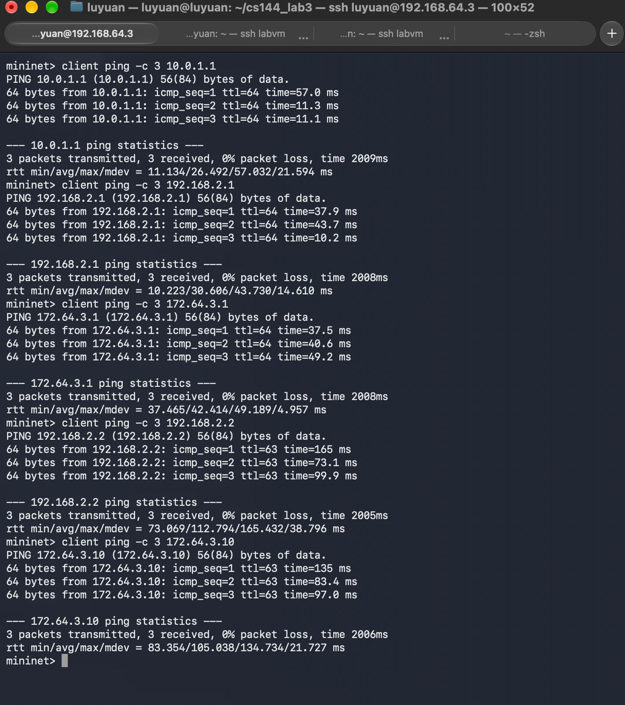
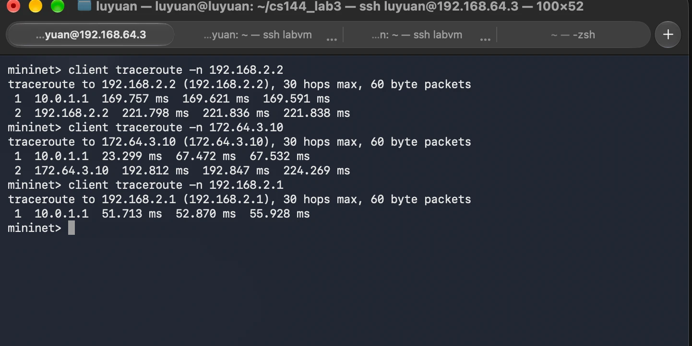
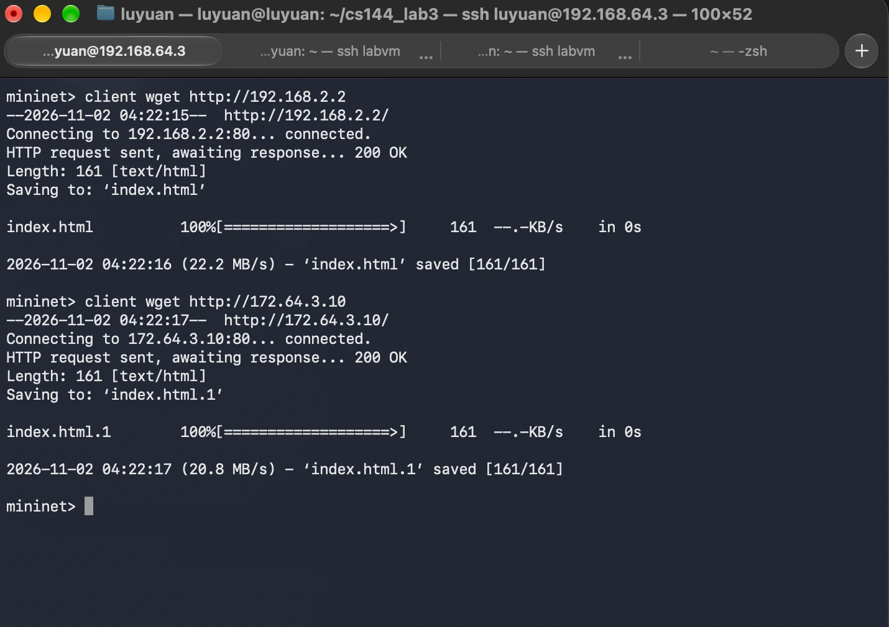
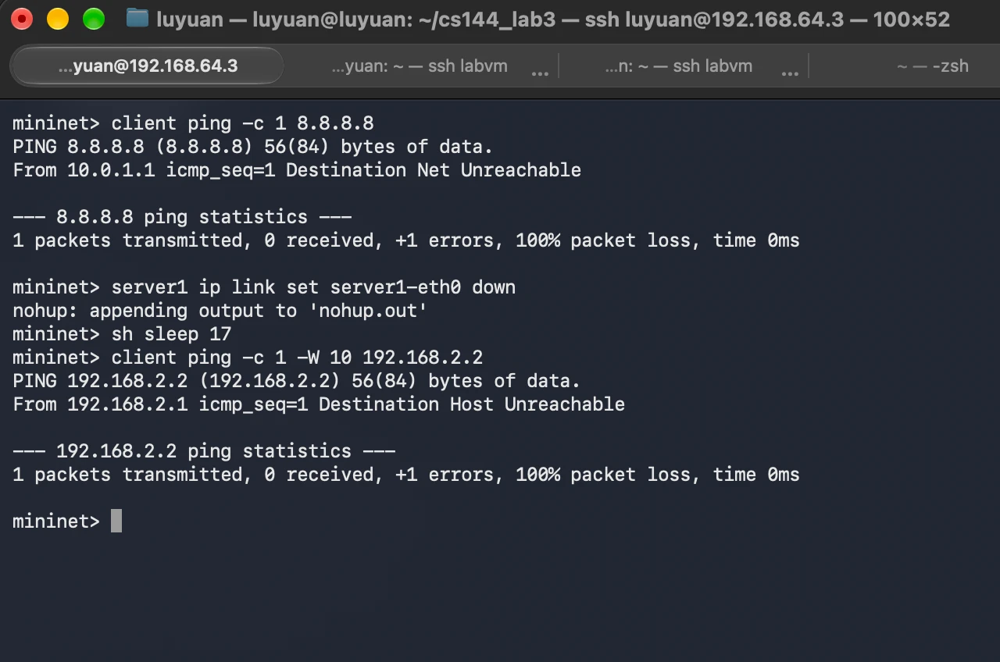
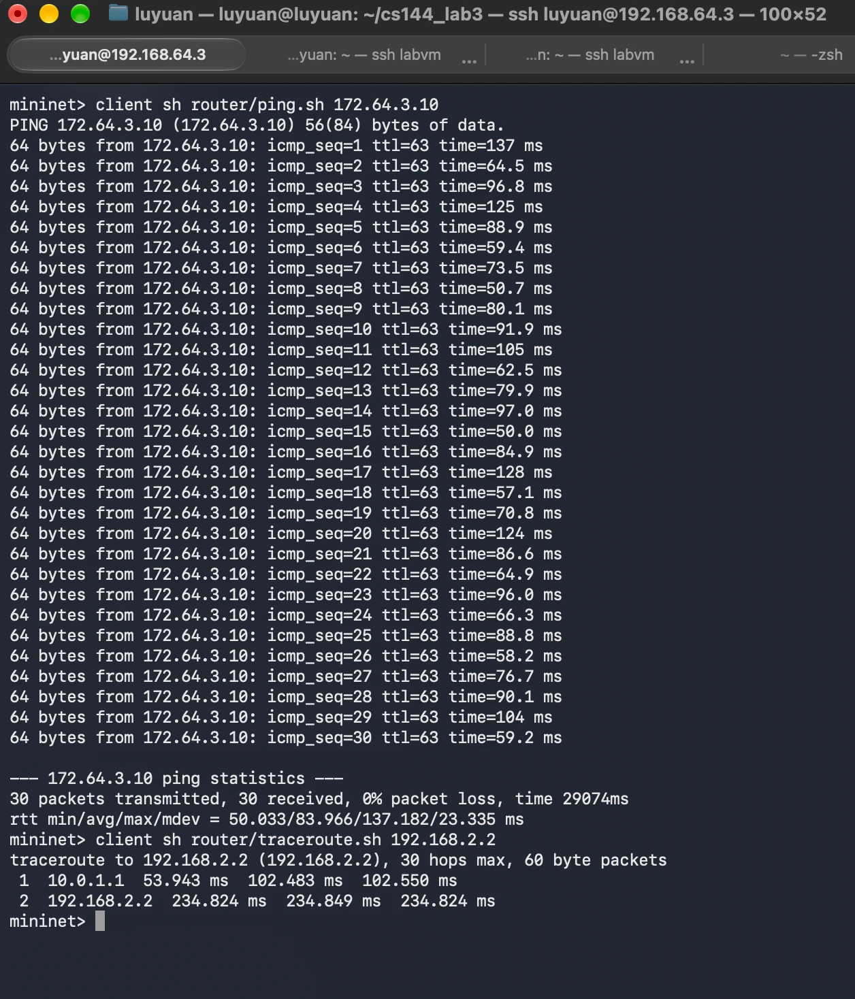

# A3: Simple Router

**Name:** Luyuan Ge  
**Student ID:** 1009039951  
**Course:** CSCD58  

I did this assignment on my own (no group).

---

## What I wrote

Basically all the router logic is in `router/sr_router.c` and
`router/sr_arpcache.c`. The header files (`sr_router.h`, `sr_arpcache.h`,
`sr_protocol.h`) just got a few function declarations and constants, like
the TCP/UDP protocol numbers and the ICMP types/codes, so I don't have magic
numbers everywhere.

### In `sr_router.c`

- **`sr_handlepacket`**: where every frame comes in. It finds which interface
  the frame arrived on, checks the EtherType, and hands it to the ARP or IP
  handler. Anything else (IPv6 and so on) just gets ignored.
- **`sr_handle_arp`**: deals with ARP that's asking about the interface it
  came in on.
  - If it's a **request**, I send back a reply with my MAC.
  - If it's a **reply**, I put it in the ARP cache. Then I send out
    everything that was waiting on that IP (in the order it arrived) and free
    the request.
- **`sr_send_arp`**: builds one ARP frame and sends it. A reply goes straight
  to whoever asked; a request gets broadcast.
- **`sr_send_arp_request`**: broadcasts "who has this IP?" out of the
  interface the waiting packets are going to leave from.
- **`sr_send_frame`**: fills in the source/destination MAC and sends the
  frame.
- **`sr_reverse_packets`**: the provided queue adds new packets at the front,
  so I flip the list before sending. Otherwise packets would go out
  backwards.
- **`sr_handle_ip`**: first checks the IP header is long enough and the
  checksum is right.
  - If the packet is for one of my IPs, it goes to `sr_handle_ip_for_us`.
  - Otherwise I forward it:
    - TTL is about to hit 0 → send ICMP time exceeded (11/0).
    - No matching route → send ICMP net unreachable (3/0).
    - Otherwise TTL − 1, recompute the checksum, and send it to the next hop.
- **`sr_handle_ip_for_us`**: a ping gets an echo reply, TCP/UDP gets port
  unreachable (3/3) (that's how traceroute knows it reached me), and anything
  else gets ignored.
- **`sr_send_echo_reply`**: checks the ICMP checksum, flips the source and
  destination, changes the type to echo reply, and sends it back.
- **`sr_is_our_ip`**: just checks if an IP belongs to one of my interfaces.
- **`sr_longest_prefix_match`**: goes through the routing table and picks the
  matching entry with the longest mask.
- **`sr_send_to_next_hop`**: if I already know the next hop's MAC, it sends
  right away. If not, it queues the packet and sends an ARP request.
- **`sr_send_icmp_error`**: builds the ICMP error messages (3/0, 3/1, 3/3,
  11/0) and sends them back to whoever sent the original packet. The message
  includes the original IP header + 8 bytes, like the spec says.

### In `sr_arpcache.c`

- **`sr_arpcache_sweepreqs`**: runs every second and calls `sr_handle_arpreq`
  on every ARP request that's still waiting.
- **`sr_handle_arpreq`**: resends the ARP request (at most once a second). If
  it's been sent 5 times with no reply, it gives up. Every packet waiting on
  it gets an ICMP host unreachable (3/1) sent back to its source, and then
  the packets are dropped.

---

## How I tested it

### Running it

Open three terminals and start these in order:

```bash
cd ~/cs144_lab3 && ./run_mininet.sh       # 1. Mininet
cd ~/cs144_lab3 && ./run_pox.sh           # 2. POX (wait until it says "Connected to ...")
cd ~/cs144_lab3/router && make && ./sr    # 3. my router
```

Then just type the commands from the screenshots below at the `mininet>`
prompt.

A couple of things to know:

- **Host unreachable (3/1):** I take `server1`'s link down, wait 17 seconds
  so the router's ARP entry for it (15 s) expires, then ping it once. Nothing
  else gets sent after that, so the "Host Unreachable" has to come from the
  once-a-second ARP sweep, which is exactly what the spec asks for.
- **Traceroute:** leave a few seconds between runs. The servers' Linux kernel
  rate-limits ICMP errors, so if you run them back to back you can get
  `* * *` at the server hop. My router still forwards every probe.
  Sometimes you'll also see a single `*` at hop 1. That's traceroute being
  impatient: once one reply for a hop comes back, it only waits about 3x that
  long for the others. I checked with tcpdump, and all three replies do
  arrive, and with `traceroute -w 5,0,0` it never shows up.

### Results

| What I tested | What happened |
|---|---|
| Ping the 3 router interfaces | All replies, 0% loss |
| Ping both servers through the router | All replies, 0% loss, `ttl=63` |
| Don't drop packets while waiting for ARP (router starts with an empty cache) | `icmp_seq=1` always gets a reply |
| Traceroute to the router's interfaces | 1 hop |
| Traceroute to both servers | 2 hops: `10.0.1.1`, then the server |
| `wget` both servers | `200 OK` |
| Ping something with no route (3/0) | `From 10.0.1.1 … Destination Net Unreachable` |
| ARP gives up after 5 tries (3/1), no extra traffic | `From 192.168.2.1 … Destination Host Unreachable` after about 5 s |
| The provided `router/ping.sh` (30 pings) and `router/traceroute.sh` | 30/30 replies, 2 hops |

I also ran the same things with the provided `sr_solution`, and it gives the
same output.

**Ping**



**Traceroute**



**wget**



**Net unreachable and host unreachable**



**The provided `ping.sh` and `traceroute.sh`**



---

## Running it on Ubuntu 22.04

The setup scripts we were given are written for an older VM with Python 2.
I worked on Ubuntu 22.04 (ARM64) with Mininet 2.3.0 instead, and three of the
scripts needed small fixes to run there. These scripts only set up the test
network, so they have nothing to do with the router code itself.

- **`lab3.py`**
  - Added `protocols=["OpenFlow10"]` to `addSwitch`. The handout (Appendix A)
    already says to do this, because this POX only speaks OpenFlow 1.0.
  - Switched it to Python 3 (shebang + `print(...)`), because Mininet on
    22.04 only works with Python 3.
  - Pinned the controller to `127.0.0.1:6633`. Mininet 2.3 tries port 6653
    if POX isn't running yet, but this POX listens on 6633.
- **`run_mininet.sh`**: `python` → `python3`. Ubuntu 22.04 doesn't even have
  a `python` command.
- **`config.sh`**: `sudo python setup.py develop` →
  `python2 -m pip install --user -e .`. It does the same install, just with
  Python 2 called directly, so I didn't have to change the system's default
  `python`.

If you're on the course VM, the original scripts work fine as is.

**Setting up 22.04 from scratch:**

```bash
sudo apt-get install -y git build-essential mininet openvswitch-switch \
    openvswitch-testcontroller python2 python2-dev traceroute tcpdump
curl -sS https://bootstrap.pypa.io/pip/2.7/get-pip.py | python2 - --user
# Twisted 20.3 is the last version that supports Python 2. Install these two
# first, otherwise pip grabs newer versions that need Python 3.
python2 -m pip install --user typing "incremental<22"
python2 -m pip install --user "Twisted==20.3.0"

git clone https://github.com/noxrepo/pox ~/pox
git -C ~/pox checkout f95dd1a81584d716823bbf565fa68254416af603
cd ~/cs144_lab3 && ln -s ../pox && ./config.sh   # this also installs ltprotocol
```

After that, start everything the same way as in "Running it" above.
